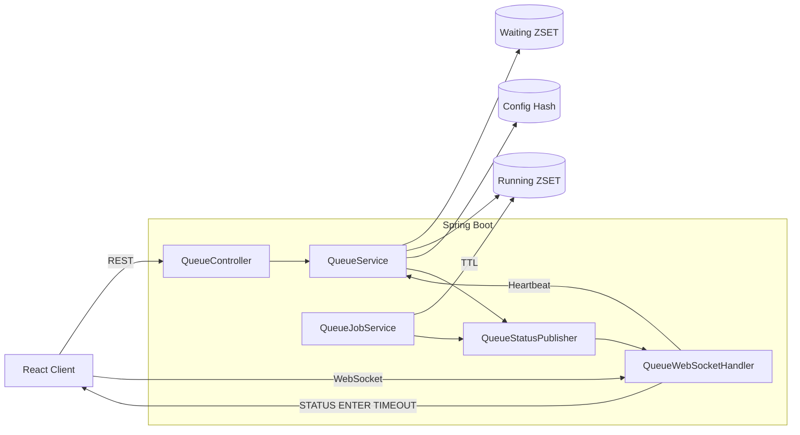

# QueueSystem

Redis와 WebSocket을 활용해 **순간적인 트래픽을 제어하기 위한 대기열 시스템**입니다.

서비스의 동시 이용 인원을 제한하고, 초과 사용자는 Redis 기반 대기열에서 순서를 관리합니다.
대기 상태는 WebSocket으로 실시간 전달하며, 비정상 종료 사용자는 Heartbeat와 TTL을 이용해 자동으로 정리합니다.

이 프로젝트는 G마켓 Red Carpet 대기열 구조를 참고하여 구현했으며, 이후 실제 운영 중인 YuGiOhDeck 프로젝트에 적용하면서 구조를 개선했습니다.

---

# 프로젝트 소개

## 목표

동시 접속자가 몰리는 상황에서도

- 서비스 이용 순서를 보장하고
- 서버 부하를 제어하며
- 사용자에게 실시간으로 현재 상태를 제공하는 것

을 목표로 구현했습니다.

---

## 주요 기능

- Redis Sorted Set 기반 대기열
- VIP / Main 다중 대기열
- Lua Script를 이용한 원자적 입장 처리
- WebSocket 기반 실시간 상태 알림
- Heartbeat + TTL 기반 비정상 종료 처리
- 관리자 API를 통한 실시간 Queue 설정 변경

---

## 기술 스택

| 분야 | 기술 |
|------|------|
| Language | Java 21 |
| Framework | Spring Boot 3 |
| Queue | Redis Sorted Set |
| Realtime | WebSocket |
| Atomic Operation | Redis Lua Script |
| Frontend | React |
| Build | Gradle |

---

# 시스템 아키텍처



---

# Redis 데이터 구조

대기열 상태는 모두 Redis에 저장됩니다.

| Key | 설명 |
|------|------|
| waiting:{group}:vip | VIP 대기열 |
| waiting:{group}:main | 일반 대기열 |
| running:{group}:vip | VIP 이용 중 |
| running:{group}:main | 일반 이용 중 |
| config:{group} | Queue 설정 |
| seq:{group} | 순번 생성 |

Running Queue는 마지막 Heartbeat 시간을 score로 저장하고,

Waiting Queue는 입장 시각과 우선순위를 score로 저장합니다.

---

# 핵심 구현

## 1. Redis Sorted Set 기반 대기열

### 왜 Redis를 사용했는가?

순간적인 트래픽에서는

- 빠른 삽입
- 빠른 삭제
- 현재 순번 조회

가 모두 중요합니다.

Redis Sorted Set은

- ZADD
- ZREM
- ZRANK

연산을 모두 O(log N)에 수행할 수 있으며,

score를 이용해 대기 순서와 우선순위를 동시에 관리할 수 있기 때문에 선택했습니다.

### 구현

- VIP / Main Queue 분리
- Waiting / Running 분리
- 그룹(site, predict) 분리
- score 기반 순번 관리

```text
Waiting

↓

Redis ZSET

↓

Running

↓

Service
```

---

## 2. Redis Lua Script

### 왜 Lua Script를 사용했는가?

입장 과정은

- 현재 Running 확인
- 중복 확인
- Waiting 등록
- Running 승격

여러 Redis 명령으로 이루어집니다.

이를 각각 실행하면 동시에 요청이 들어왔을 때

- Running 초과
- 중복 입장
- 순서 꼬임

이 발생할 수 있습니다.

### 해결

입장과 승급을 하나의 Lua Script에서 실행하도록 구성했습니다.

Redis 내부에서 하나의 명령처럼 수행되므로 Race Condition을 방지할 수 있습니다.

---

## 3. WebSocket 기반 실시간 상태 전달

### 왜 WebSocket을 사용했는가?

대기 순번은 실시간으로 변하는 데이터입니다.

Polling 방식은 사용자가 많아질수록 동일한 요청이 계속 발생합니다.

반면 WebSocket은

순번이 변경될 때만 서버가 사용자에게 메시지를 전달하므로

네트워크 비용과 서버 부하를 줄일 수 있습니다.

### 전달하는 이벤트

- STATUS
- ENTER
- TIMEOUT

사용자는 새로고침 없이 현재 대기 상태를 확인할 수 있습니다.

---

## 4. Heartbeat 기반 세션 관리

### 왜 Heartbeat가 필요한가?

브라우저를 강제로 종료하거나

네트워크가 끊기면

서버는 사용자가 실제로 서비스를 떠났는지 알 수 없습니다.

이를 해결하기 위해

클라이언트는 5초마다 PING을 보내고,

서버는 마지막 Heartbeat 시간을 Running Queue에 저장합니다.

TTL을 초과한 사용자만 자동 제거하도록 구현했습니다.

```text
PING

↓

Running score 갱신

↓

TTL 검사

↓

만료

↓

Waiting 승격
```

이 구조를 통해

- 새로고침
- 일시적인 네트워크 장애

는 즉시 퇴장으로 처리하지 않고,

실제 비정상 종료 사용자만 자동으로 제거할 수 있습니다.

---

## 5. 관리자 설정

관리자는 API를 통해 Queue 설정을 변경할 수 있습니다.

지원 항목

- maxRunning
- sessionTtlMillis
- throughput

Redis Hash를 이용하므로 서버를 재시작하지 않아도 즉시 적용됩니다.

---

## 6. 처리 흐름

```text
사용자 입장

↓

QueueController

↓

QueueService

↓

Lua Script

↓

Running 가능?

├── YES → Running

└── NO → Waiting

↓

WebSocket STATUS

↓

Heartbeat

↓

TTL 검사

↓

Running 제거

↓

Waiting 승격

↓

ENTER 전송
```

---

## 7. 실행 방법

### Redis 실행

```bash
docker run -p 6379:6379 redis
```

### Backend

```bash
./gradlew bootRun
```

### Frontend

```bash
cd front/my-app

npm install

npm start
```

브라우저에서

```
http://localhost:3000
```

접속 후

userId를 입력하면 대기열을 테스트할 수 있습니다.
---

# 8. 트러블슈팅

## 8-1. WebSocket 재연결 시 사용자가 대기열에서 사라지는 문제

### 문제

초기 구현에서는 WebSocket 연결이 종료되면 사용자가 서비스를 떠난 것으로 판단하여 `leave()`를 호출했습니다.

하지만 실제 서비스에서는

- 브라우저 새로고침
- 일시적인 네트워크 끊김
- 모바일 네트워크 전환

과 같은 상황에서도 WebSocket 연결 종료가 발생합니다.

그 결과 정상 사용자가 Running Queue에서 제거되고, 다음 대기자가 잘못 승급되는 문제가 발생했습니다.

### 원인

WebSocket 연결 상태와 Redis에 저장된 실제 이용 상태를 동일한 생명주기로 관리하고 있었습니다.

```text
WebSocket 종료
↓
leave()
↓
Running 제거
↓
Waiting 승급
```

### 해결

WebSocket 연결과 Redis Queue 상태의 생명주기를 분리했습니다.

WebSocket 종료 시에는 메모리상의 세션만 제거하고, Redis의 Running/Waiting 상태는 유지하도록 변경했습니다.

실제 Queue 제거는 다음 두 경우에만 수행하도록 했습니다.

- 사용자가 명시적으로 `POST /queue/leave`를 호출한 경우
- Heartbeat가 중단되고 TTL이 만료된 경우

```text
WebSocket 종료
↓
메모리 세션 제거
↓
Redis 상태 유지

Heartbeat 중단
↓
TTL 만료
↓
Running 제거
↓
Waiting 사용자 승급
```

이를 통해 새로고침이나 일시적인 네트워크 장애가 실제 퇴장으로 처리되지 않도록 개선했습니다.

---

## 8-2. 여러 Redis 명령 실행으로 순서가 꼬이는 문제

### 문제

입장 과정은

- 현재 Running 인원 확인
- 중복 사용자 확인
- Waiting 등록
- Running 승격

등 여러 Redis 명령으로 구성되어 있었습니다.

이 작업을 Java 코드에서 각각 실행하면 동시에 여러 요청이 들어왔을 때 동일한 빈 슬롯을 확인하거나, Running 정원을 초과하는 Race Condition이 발생할 수 있었습니다.

### 해결

입장과 승급에 필요한 Redis 명령을 하나의 Lua Script로 묶어 Redis 내부에서 원자적으로 처리하도록 변경했습니다.

이를 통해 여러 사용자가 동시에 접근하더라도 중간 상태에 다른 요청이 개입하지 않도록 했습니다.

---

## 8-3. VIP와 Main 사용자의 Running Queue가 섞이는 문제

### 문제

기존 승급 로직에서는 빈자리가 발생한 Running Queue를 기준으로 사용자를 넣었습니다.

이 때문에 Main 사용자가 VIP Running에 들어가거나, VIP 사용자가 Main Running에 들어갈 가능성이 있었습니다.

### 해결

Lua Script에서 실제로 사용자를 꺼낸 Waiting Queue를 추적하도록 수정했습니다.

```text
waiting:{group}:vip
→ running:{group}:vip

waiting:{group}:main
→ running:{group}:main
```

VIP와 Main은 등급별 Running Queue를 유지하면서도, 두 Running Queue의 합으로 하나의 `maxRunning` 정원을 공유하도록 구성했습니다.

---

## 8-4. 순번 계산 시 Redis 호출이 과도하게 발생하는 문제

### 문제

초기에는 모든 대기자를 조회한 뒤 각 사용자마다 `ZRANK`를 다시 호출하여 순번을 계산했습니다.

```text
ZRANGE
↓
User 1 → ZRANK
User 2 → ZRANK
User 3 → ZRANK
...
```

대기자가 많아질수록 Redis 호출 수도 함께 증가했습니다.

### 해결

`ZRANGE` 결과가 이미 정렬된 순서대로 반환된다는 점을 이용해 반복문의 index를 순번으로 사용하도록 변경했습니다.

```text
ZRANGE
↓
반환 순서의 index 사용
```

이를 통해 사용자마다 발생하던 추가 `ZRANK` 호출을 제거했습니다.

---

## 8-5. WebSocket 중복 연결과 동시 전송 문제

### 문제

같은 사용자가 재연결할 경우 이전 WebSocket과 새로운 WebSocket이 동시에 존재할 수 있었고, 여러 스레드가 동일한 Session에 동시에 메시지를 전송할 가능성도 있었습니다.

### 해결

다음 방식으로 WebSocket 세션 관리를 보완했습니다.

- `group + userId` 기준으로 최신 연결만 유지했습니다.
- 이전 세션 종료가 새로운 세션을 제거하지 않도록 현재 세션을 비교했습니다.
- `ConcurrentWebSocketSessionDecorator`를 적용해 동일 Session의 동시 전송을 보호했습니다.
- 이미 닫힌 Session에는 메시지를 전송하지 않도록 처리했습니다.
- `group`, `qid`, `userId`를 연결 직후 검증하고 잘못된 요청은 종료하도록 했습니다.

---

# 9. REST API

| Method | API | 설명 |
|---|---|---|
| `POST` | `/queue/enter` | 대기열에 입장합니다. |
| `POST` | `/queue/leave` | Waiting 또는 Running 상태에서 사용자를 제거합니다. |
| `GET` | `/queue/status` | 현재 전체 Queue 상태를 조회합니다. |
| `GET` | `/queue/position` | 사용자의 현재 대기 순번을 조회합니다. |
| `GET` | `/queue/isRunning` | 사용자가 현재 Running 상태인지 확인합니다. |

현재 지원하는 값은 다음과 같습니다.

```text
group: site | predict
qid: vip | main
```

---

# 10. WebSocket

WebSocket 엔드포인트는 다음과 같습니다.

```text
ws://localhost:8080/queue-status
```

클라이언트는 연결 후 주기적으로 `PING`을 전송합니다.

```text
PING
```

서버는 사용자 상태에 따라 다음 메시지를 전달합니다.

```text
STATUS
```

현재 대기 순번과 Running / Waiting 상태를 전달합니다.

```text
ENTER
```

사용자가 Running 상태로 승격되어 서비스에 입장할 수 있음을 알립니다.

```text
TIMEOUT
```

Heartbeat TTL이 만료되어 Running 상태에서 제거되었음을 알립니다.

WebSocket 종료 자체는 실제 퇴장으로 처리하지 않습니다. 정상적으로 서비스를 떠나는 경우에는 반드시 `POST /queue/leave`를 호출해야 합니다.

---

# 11. 운영 및 확장 시 고려 사항

현재 Queue 상태는 Redis에 저장되므로 여러 애플리케이션 인스턴스가 동일한 상태를 공유할 수 있습니다.

다만 WebSocket Session은 각 Spring Boot 인스턴스의 메모리에 저장됩니다.

```text
Instance A WebSocket Map
          │
          ├── Redis Queue State
          │
Instance B WebSocket Map
```

따라서 다중 서버 환경으로 확장할 경우 다음과 같은 추가 구성이 필요합니다.

- Redis Pub/Sub 또는 Streams를 이용한 인스턴스 간 메시지 전달
- Sticky Session 적용
- 별도의 WebSocket Gateway와 세션 라우팅 구조 도입

또한 현재 `STATUS` 메시지는 대기 사용자 수에 비례해 전송량이 증가합니다.

대기 규모가 커질 경우 다음과 같은 최적화를 고려할 수 있습니다.

- 일정 범위 이상 순번이 변경된 경우에만 Push
- 개인 순번을 주기적으로 조회하는 방식과 혼합
- 상태 발행 주기 제한
- 전체 상태와 개인 알림 채널 분리

---

# 12. 향후 개선

현재 구조에서 다음 기능을 추가로 고려하고 있습니다.

- Redis Pub/Sub 기반 다중 서버 WebSocket 메시지 전달
- JWT 또는 서명된 Queue Token 기반 사용자 식별
- Prometheus / Grafana를 이용한 Queue 모니터링
- 그룹별 Running / Waiting / TTL 만료 / 승급 지표 수집
- 대기 인원과 처리 속도를 기반으로 한 예상 대기 시간 제공
- 대규모 Queue 환경에서의 STATUS 전송 최적화
- 운영 환경에서 WebSocket Origin 제한 강화
