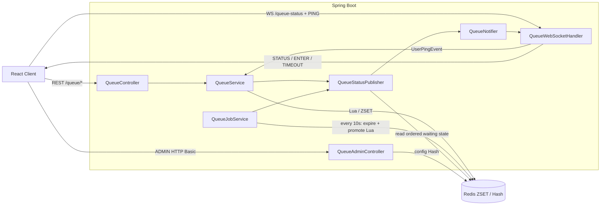

# QueueSystem

Spring Boot, Redis **대기열 시스템**  

## 2026-07-30 업데이트

YuGiOhDeck에서 운영 중인 대기열 구현을 독립 프로젝트에 동기화했다.

- `site`, `predict` 그룹별 Redis 키 분리
- `vip`, `main` 대기열과 전체 Running 정원 통합 관리
- Redis Lua 스크립트로 입장 및 승급을 원자적으로 처리
- WebSocket 세션을 `group + userId` 기준으로 관리하고 중복 연결 교체
- WebSocket 종료는 일시 장애로 간주하며, 명시적 `/queue/leave` 또는 heartbeat TTL 만료 때만 Redis에서 제거
- WebSocket 연결 파라미터 검증 및 동시 전송 보호
- 5초 heartbeat와 그룹별 세션 TTL 만료 처리
- Running 이탈·만료 시 Waiting 사용자를 즉시 승급
- Redis 정렬 결과의 인덱스로 순번을 계산해 사용자별 `STATUS` 메시지 전송
- `STATUS.running`은 전체 Running이며 `runningVip`, `runningMain`을 함께 제공
- REST API의 `group`, `qid`, `userId` 입력값 검증
- 관리자 API에서 그룹별 `throughput`, `sessionTtlMillis`, `maxRunning` 설정 지원
- React 데모가 현재 호스트의 WebSocket을 사용하고 heartbeat를 전송하도록 변경

기본 TTL은 `30,000ms`, 기본 최대 Running 수는 그룹별 `30명`이다. 운영 환경에서는 Redis의 `config:{site}`, `config:{predict}` 해시로 값을 조정할 수 있다.

검증:

```bash
cd queueSystem
./gradlew test

cd ../front/my-app
npm ci
npm run build
```

---

## 📦 주요 기능

- **그룹별 Running 정원 관리**: `site`, `predict`가 각각 독립적인 `maxRunning`을 사용한다.
- **등급별 대기열**: 그룹 안에서 `vip`, `main` Waiting과 Running을 구분한다.
- **원자적 입장 처리**: Lua가 정원, 중복 등록, 즉시 입장, Waiting 등록을 한 번에 처리한다.
- **VIP 공정성 정책**: VIP를 우선하되 연속 3명 승급 후 Main 대기자가 있으면 Main을 선택한다.
- **명시적 퇴장과 TTL 만료**: `/queue/leave`는 즉시 제거하며 비정상 종료는 heartbeat TTL로 정리한다.
- **원자적 만료·승급**: TTL 만료 사용자 제거와 빈자리 승급을 하나의 Lua 스크립트에서 처리한다.
- **개인 WebSocket 알림**: 사용자별로 `STATUS`, `ENTER`, `TIMEOUT` 메시지를 전송한다.
- **전체 Running 집계 통일**: REST와 WebSocket 모두 VIP+Main 전체를 `running`으로 제공한다.
- **중복 WebSocket 교체**: `group + userId` 기준으로 최신 연결만 유지한다.
- **관리자 설정 API**: HTTP Basic ADMIN 인증 후 그룹별 설정을 조회·변경할 수 있다.
- **React 데모 UI**: 입장, 명시적 퇴장, heartbeat, 순번 및 Running 현황 표시를 제공한다.

### Redis 데이터 모델

모든 상태 키는 ZSET이고, 같은 그룹의 키는 Redis Cluster에서 동일 슬롯을 사용하도록 `{group}` hash tag를 포함한다.

| 용도 | 키 예시 | ZSET score |
| --- | --- | --- |
| VIP Running | `running:{site}:vip` | 마지막 heartbeat 시각(ms) |
| Main Running | `running:{site}:main` | 마지막 heartbeat 시각(ms) |
| VIP Waiting | `waiting:{site}:vip` | 우선순위가 반영된 입장 점수 |
| Main Waiting | `waiting:{site}:main` | 입장 시각과 sequence 기반 점수 |
| 그룹 설정 | `config:{site}` | Redis Hash |
| 동순위 방지 sequence | `seq:{site}` | Redis String counter |

---

## 🏗️ 아키텍처



### 컴포넌트 역할

1. **QueueController**
   - `/queue/enter`, `/queue/leave`, `/queue/position`, `/queue/status`, `/queue/isRunning` 제공
   - `QueueValidator`를 통해 `group`, `qid`, `userId` 검증
2. **QueueService**
   - 입장·명시적 퇴장·heartbeat 갱신 처리
   - 입장과 승급을 Lua로 원자적으로 실행
3. **QueueJobService**
   - 10초마다 Running TTL 만료 검사
   - 만료 제거와 후속 승급을 Lua로 원자 처리
4. **QueueStatusPublisher**
   - 전체 Running 및 VIP/Main Waiting을 한 형식으로 계산
   - `ZRANGE` 결과 순서로 개인 순번을 계산하고 대기자에게 상태 전송
5. **QueueWebSocketHandler**
   - `/queue-status` 연결, 중복 세션 교체, heartbeat 이벤트 발행
   - 닫힌 연결을 Redis 퇴장으로 처리하지 않음
   - 동시 전송 보호 및 사용자별 메시지 전달
6. **QueueAdminController**
   - `config:{site}`, `config:{predict}` Hash 조회·변경
   - `/admin/queue/**`는 ADMIN 권한 필요

### 주요 처리 흐름

```text
POST /queue/enter
  → 입력 검증
  → Lua에서 전체 Running 정원 및 중복 확인
  → 빈자리이고 Waiting이 없으면 즉시 Running
  → 아니면 VIP/Main Waiting에 등록
  → 전체 상태 발행

WebSocket PING
  → UserPingEvent
  → 해당 사용자의 Running score를 현재 시각으로 갱신

POST /queue/leave
  → Running/Waiting에서 즉시 제거
  → Running 빈자리 발생 시 다음 Waiting 사용자 승급
  → ENTER 및 STATUS 전송

10초 TTL 작업
  → TTL이 지난 Running 사용자 원자적 제거
  → 제거된 인원만큼 정원 내에서 Waiting 사용자 승급
  → TIMEOUT, ENTER 및 STATUS 전송
```

---

## 🚀 빠른 시작

### 선행 조건

* Java 17+, Gradle or Maven
* Redis 6+ (`localhost:6379`)
* Node.js 16+ & npm

### 백엔드 실행

```bash
cd queueSystem
./gradlew bootRun
```

### 프런트엔드 실행

```bash
cd front/my-app
npm ci
npm start
```

1. 브라우저에서 `http://localhost:3000` 열기
2. `userId` 입력 후 **입장** 클릭
3. 정원 초과 시 모달로 대기번호 확인 → 빈 자리 생기면 자동 승격

---

## ⚙️ 설정

**기본 QueueConfig** (Redis 해시가 비어 있을 때)

* `throughput = 10/sec`
* `sessionTtlMillis = 30_000ms (30초)`
* `maxRunning = 30`

---

## 🛠 트러블슈팅

WebSocket 연결 종료를 실제 서비스 퇴장으로 간주하면서 새로고침이나 일시적인 네트워크 장애에도 Running 사용자가 제거되는 문제가 있었다. 이를 해결하기 위해 WebSocket 세션과 Redis 이용 상태의 생명주기를 분리하고, Running 상태는 heartbeat TTL로 관리하도록 변경했다. 이 과정에서 VIP/Main 등급 보존, 상태 집계 방식, 순번 발행 성능과 WebSocket 동시 전송 안정성도 함께 개선했다.

### 문제 1. 일시적인 WebSocket 종료가 실제 퇴장으로 처리됨

이전에는 WebSocket이 닫히면 `UserDisconnectedEvent`를 발행하고 `QueueService.leave()`를 즉시 호출했다. 새로고침, 네트워크 전환, 일시적인 연결 장애도 실제 퇴장으로 처리되어 사용자가 Running에서 제거되고 다음 대기자가 잘못 승급할 수 있었다.

#### 해결: 즉시 `leave()` 제거 및 상태별 생명주기 분리

현재는 WebSocket 종료 시 `QueueWebSocketHandler`의 메모리 세션만 제거한다. Redis 상태 제거 기준은 다음과 같이 상태별로 다르다.

- Waiting과 Running 사용자는 명시적인 `POST /queue/leave`로 즉시 제거된다.
- Running 사용자는 마지막 heartbeat 이후 `sessionTtlMillis`가 지나면 자동 제거된다.
- Waiting 사용자의 자동 TTL 만료 정책은 현재 적용하지 않는다.

```text
WebSocket 종료
  → 메모리 WebSocket 세션만 제거
  → Redis Running/Waiting 유지

명시적 POST /queue/leave
  → Redis에서 즉시 제거
  → Running 빈자리 발생 시 다음 사용자 승급

heartbeat TTL 만료
  → 스케줄러가 Redis Running에서 만료 사용자 제거
  → 제거된 인원만큼 다음 사용자 승급
```

### 문제 2. 비정상 종료 사용자를 안전하게 정리해야 함

#### 해결: heartbeat 기반 Running 생명주기 관리

클라이언트는 WebSocket 연결 직후와 이후 5초마다 `PING`을 보낸다. 서버는 `UserPingEvent`를 통해 해당 사용자의 Running ZSET score를 현재 시각으로 갱신한다. `QueueJobService`는 10초마다 마지막 heartbeat가 TTL 기준보다 오래된 사용자를 찾아 제거한다.

TTL 안에 WebSocket을 재연결하고 `PING`을 다시 보내면 기존 Running score가 갱신되어 이용 상태를 유지한다. 반대로 `/queue/leave`를 보내지 못한 비정상 종료 사용자는 heartbeat가 중단되므로 TTL 이후 자동 정리된다.

### 문제 3. 승급 사용자의 VIP/Main Running 등급이 섞임

이전 승급 Lua는 빈자리가 발생한 Running 키에 선택된 사용자를 넣어 Main 사용자가 VIP Running에 들어가거나 그 반대가 될 수 있었다. 현재는 실제로 사용자를 꺼낸 Waiting 키를 `selectedWait`로 추적하여 VIP는 `running:{group}:vip`, Main은 `running:{group}:main`에 저장한다.

VIP와 Main은 Running 키를 등급별로 분리하지만 별도 정원을 갖지 않는다. 두 Running ZSET 크기의 합을 기준으로 그룹의 동일한 `maxRunning`을 공유한다.

### 문제 4. 상태 집계와 순번 발행 기준이 서로 다름

#### 해결: 상태 형식과 순번 계산 통일

- REST와 WebSocket의 `running`을 VIP+Main 전체 Running 수로 통일했다.
- WebSocket `STATUS`에 `runningVip`, `runningMain`을 함께 제공한다.
- VIP 상태가 변할 때 Main 대기자의 절대 순번도 다시 계산해 발행한다.
- `ZRANGE` 후 사용자마다 실행하던 반복 `ZRANK`를 제거하고 정렬 결과의 반복 인덱스로 순번을 계산한다.

단, `pos`는 현재 VIP 우선 정렬을 반영한 표시용 예상 순번이다. VIP 연속 승급 제한과 실시간 퇴장·만료에 따라 실제 입장 순서나 입장 시각은 달라질 수 있다.

### 문제 5. 잘못된 연결과 동시 전송으로 WebSocket이 불안정함

#### 해결: 연결 검증과 세션 전송 보호

- `group`, `qid`, `userId`를 연결 직후 검증하고 잘못된 요청은 WebSocket close code `1007`(`BAD_DATA`)과 `Invalid queue parameters` reason으로 종료한다.
- 동일한 `group + userId`의 새 연결이 들어오면 이전 연결을 교체한다.
- 이전 연결의 종료 처리가 새 연결을 Map에서 제거하지 않도록 현재 세션을 비교한다.
- `ConcurrentWebSocketSessionDecorator`로 동일 세션의 동시 전송을 보호한다.
- 이미 닫힌 세션에는 메시지를 전송하지 않는다.

클라이언트에서는 `onclose` 이벤트의 `code`와 `reason`으로 파라미터 거부 여부를 확인할 수 있다.

### 검증 시나리오

1. Running 사용자의 WebSocket만 닫았을 때 Redis Running 상태가 즉시 삭제되지 않는지 확인한다.
2. TTL 안에 다시 연결하고 `PING`을 보냈을 때 Running score가 갱신되는지 확인한다.
3. `PING`을 중단한 뒤 `sessionTtlMillis`와 최대 10초의 스케줄 주기가 지나면 Running에서 제거되는지 확인한다.
4. `POST /queue/leave`를 호출하면 Waiting 또는 Running에서 즉시 제거되는지 확인한다.
5. 프런트의 `beforeunload`, `pagehide`, `useEffect` cleanup 및 WebSocket `onclose`에서 `/queue/leave`를 자동 호출하지 않는지 확인한다. 현재 React 데모의 cleanup과 `onclose`는 WebSocket만 닫는다.
6. VIP/Main 승급 후 사용자가 실제 등급의 Running 키에 존재하는지 확인한다.
7. 잘못된 `group`, `qid`, `userId`로 연결했을 때 close code `1007`과 reason을 확인한다.

### 증상별 확인

| 증상 | 원인 | 현재 처리 및 확인 사항 |
| --- | --- | --- |
| 새로고침·네트워크 전환 후 연결이 끊기거나 비정상 종료 사용자가 잠시 Running에 남아 있음 | WebSocket 연결과 Redis 이용 상태의 생명주기를 분리함 | 정상 퇴장은 `POST /queue/leave`를 호출한다. 비정상 종료는 마지막 `PING` 이후 `sessionTtlMillis`가 지나면 자동 정리된다. TTL 안에 재연결한 뒤 `PING`이 도착해야 기존 상태가 갱신된다. |
| Waiting 사용자가 자동으로 만료되지 않음 | heartbeat TTL은 Running에만 적용됨 | 현재 정상 동작이다. Waiting 사용자는 명시적인 `/queue/leave`로 제거한다. 자동 정리가 필요하면 Waiting 전용 TTL 정책을 별도로 구현해야 한다. |
| WebSocket 연결 직후 종료됨 | `group`, `qid`, `userId`가 누락됐거나 허용되지 않은 값 | `group`은 `site` 또는 `predict`, `qid`는 `vip` 또는 `main`, `userId`는 공백이 아닌 값이어야 한다. 클라이언트 `onclose`에서 code `1007`과 reason을 확인한다. |
| REST와 WebSocket의 Running 수 또는 VIP/Main 상태가 예상과 다름 | 전체 Running과 등급별 Running을 혼동했거나 이전 상태 형식을 사용함 | `running`은 항상 `runningVip + runningMain`이다. WebSocket `STATUS`에서 등급별 값도 확인한다. 승급 사용자는 실제 등급에 맞는 Running 키에 저장된다. |
| Main 순번이 갱신되지 않거나 표시 순번과 실제 승급 순서가 다름 | VIP 변화가 Main 순번에 영향을 주며, 실제 승급에는 VIP 연속 승급 제한도 적용됨 | VIP와 Main 상태를 함께 다시 발행한다. `pos`는 VIP 우선 정렬 기준의 예상 순번이며 정확한 입장 시각을 보장하지 않는다. |
| Redis에서 `WRONGTYPE` 오류 발생 | 기존 데이터가 현재 ZSET 기반 키 구조와 다른 타입으로 남아 있음 | Running/Waiting 키 타입을 확인한다. 이전 버전의 SET 키가 남아 있다면 서비스 중단 및 데이터 보존 정책을 정한 뒤 ZSET 구조로 마이그레이션한다. |
| 관리자 API가 `401` 또는 `403`을 반환함 | HTTP Basic 인증 정보가 없거나 ADMIN 권한이 없음 | 올바른 관리자 계정을 사용하고 Spring Security 설정을 확인한다. |
| 다른 사용자의 `userId`로 Queue API 또는 WebSocket 요청이 가능함 | 일반 Queue API가 클라이언트의 `userId`를 신뢰함 | 현재 알려진 보안 제한이다. 운영에서는 세션, JWT 또는 서명된 queue token으로 서버가 사용자 ID를 결정해야 한다. |

### 현재 남은 제한사항

- Waiting 사용자의 자동 만료 정책은 없다.
- `STATUS` 발행은 모든 대기자를 읽고 개인 메시지를 보내므로 전송량이 대기자 수에 비례한다.
- `pos`는 표시용 예상 순번이며 정확한 입장 순서나 입장 시각을 보장하지 않는다.
- 일반 Queue API와 WebSocket은 아직 클라이언트가 전달한 `userId`를 신뢰한다.
- WebSocket 세션 Map은 인스턴스 메모리에 있으므로 다중 서버에서는 Pub/Sub, sticky session 또는 별도 세션 라우팅이 필요하다.

---

## ⚡ 확장 & 운영

### 1) 관리자 설정

관리자 API는 HTTP Basic 인증이 필요하다. 기본 개발 계정은 애플리케이션 기본값일 뿐이며 운영에서는 반드시 환경별로 변경한다.

```properties
app.admin.username=queue-admin
app.admin.password-hash={bcrypt}<bcrypt-password-hash>
```

현재 설정 조회:

```bash
curl -u queue-admin:password \
  http://localhost:8080/admin/queue
```

그룹별 설정 변경:

```bash
curl -u queue-admin:password -X POST \
  "http://localhost:8080/admin/queue/site?sessionTtlMillis=60000&maxRunning=50"
```

| 필드 | 기본값 | 현재 용도 |
| --- | ---: | --- |
| `sessionTtlMillis` | `30000` | 마지막 heartbeat 이후 Running 만료 기준 |
| `maxRunning` | `30` | VIP+Main 전체 Running 정원 |
| `throughput` | `10` | 설정·조회는 지원하지만 현재 승급 Lua의 처리량 제한에는 사용하지 않음 |

`throughput`을 실제 초당 승급 제한으로 사용하려면 별도의 rate-limit 정책과 원자적 카운터를 추가해야 한다.

### 2) REST API

| Method | Path | 주요 파라미터 | 응답/동작 |
| --- | --- | --- | --- |
| `POST` | `/queue/enter` | `group`, `qid`, `userId` | `{entered, position}` |
| `POST` | `/queue/leave` | `group`, `qid`, `userId` | Running/Waiting에서 명시적 제거 |
| `GET` | `/queue/position` | `group`, `qid`, `userId` | `{pos}` |
| `GET` | `/queue/status` | `group` | 전체 Running 및 VIP/Main Waiting |
| `GET` | `/queue/isRunning` | `group`, `qid`, `userId` | `{running, pos}` |

허용 값은 현재 코드에 고정되어 있다.

```text
group: site | predict
qid:   vip | main
```

새 그룹이나 등급을 추가하려면 `QueueValidator`, 스케줄 대상, 설정 로딩 및 Lua 키 구성을 함께 확장해야 한다. 설정 파일에 이름만 추가하는 동적 확장은 아직 지원하지 않는다.

### 3) WebSocket 계약

연결 URL:

```text
ws://localhost:8080/queue-status?group=site&qid=main&userId=user123
```

클라이언트는 연결 직후와 이후 5초마다 텍스트 `PING`을 전송한다. 서버 메시지는 JSON이다.

```json
{
  "type": "STATUS",
  "group": "site",
  "qid": "main",
  "running": 30,
  "runningVip": 10,
  "runningMain": 20,
  "waitingVip": 5,
  "waitingMain": 8,
  "waiting": 13,
  "pos": 9
}
```

```json
{"type":"ENTER"}
```

```json
{"type":"TIMEOUT"}
```

WebSocket 종료는 퇴장 요청이 아니다. 정상적으로 서비스를 떠날 때는 반드시 `POST /queue/leave`를 호출해야 하며, 호출하지 못한 비정상 종료는 TTL 작업이 정리한다.

### 4) Redis Cluster

한 Lua 호출에 사용되는 그룹별 키는 동일한 hash tag를 공유한다.

```text
running:{site}:vip
running:{site}:main
waiting:{site}:vip
waiting:{site}:main
config:{site}
seq:{site}
```

따라서 `site`와 `predict`는 서로 다른 슬롯에 배치될 수 있고, 각 그룹 내부 Lua 연산은 동일 슬롯에서 실행된다. 키 이름을 변경할 때는 `{group}` 부분을 유지해야 한다.

### 5) 수평 확장 시 고려 사항

Redis 상태와 Lua 원자성은 여러 애플리케이션 인스턴스에서도 공유되지만 WebSocket 세션 Map은 각 인스턴스의 로컬 메모리에 있다.

```text
Instance A WebSocket Map ─┐
                          ├─ Redis queue state
Instance B WebSocket Map ─┘
```

현재 `QueueNotifier`는 로컬 인스턴스에 연결된 사용자에게만 메시지를 보낼 수 있다. 다중 인스턴스에서는 다음 중 하나가 필요하다.

- Redis Pub/Sub 또는 Streams로 사용자 알림을 모든 인스턴스에 전달
- WebSocket sticky session 적용
- 전용 WebSocket gateway와 세션 라우팅 저장소 도입

스케줄러도 모든 인스턴스에서 실행된다. Lua가 상태 변경을 원자적으로 처리해 중복 승급 위험을 줄이지만, 운영 부하와 알림 중복을 통제하려면 리더 선출 또는 분산 락을 고려한다.

### 6) 대규모 대기열

현재 상태 발행은 반복 `ZRANK`를 제거했지만 `ZRANGE 0 -1`로 모든 대기자를 읽고 사용자별 WebSocket 메시지를 전송한다. 대기자가 매우 많으면 Redis 응답 크기와 전송량이 선형으로 증가한다.

대규모 운영에서는 다음 개선을 고려한다.

- 상태 발행 주기를 제한하고 짧은 시간의 변경을 합치기
- 사용자의 순번이 일정 범위 이상 변했을 때만 push
- 개인 순번은 클라이언트가 3~5초 간격으로 조회
- 전체 현황과 개인 알림 채널 분리
- 메트릭: 그룹별 Running/Waiting, 만료 수, 승급 수, Lua 지연, WebSocket 전송 실패율

### 7) 인증과 신뢰 경계

- `/admin/queue/**`는 ADMIN 권한으로 보호된다.
- 일반 Queue REST와 WebSocket의 `userId`는 현재 클라이언트 입력을 신뢰한다.
- 운영 환경에서는 로그인 세션/JWT의 subject 또는 서버가 서명한 queue token에서 `userId`, `group`, `qid`를 결정해야 한다.
- WebSocket allowed origin은 현재 `*`이므로 운영 배포에서는 허용 프런트엔드 origin으로 제한해야 한다.
- 기본 Redis 비밀번호와 관리자 기본 계정을 운영 환경에서 사용하지 않는다.


## 📖 참고 자료

* [G마켓 Dev Blog: Redcarpet 대기열 구조](https://dev.gmarket.com/46)
* [Redis Sorted Set (ZSET) 문서](https://redis.io/docs/data-types/sorted-sets/)
* [Spring Boot WebSocket 가이드](https://spring.io/guides/gs/messaging-stomp-websocket/)

---
